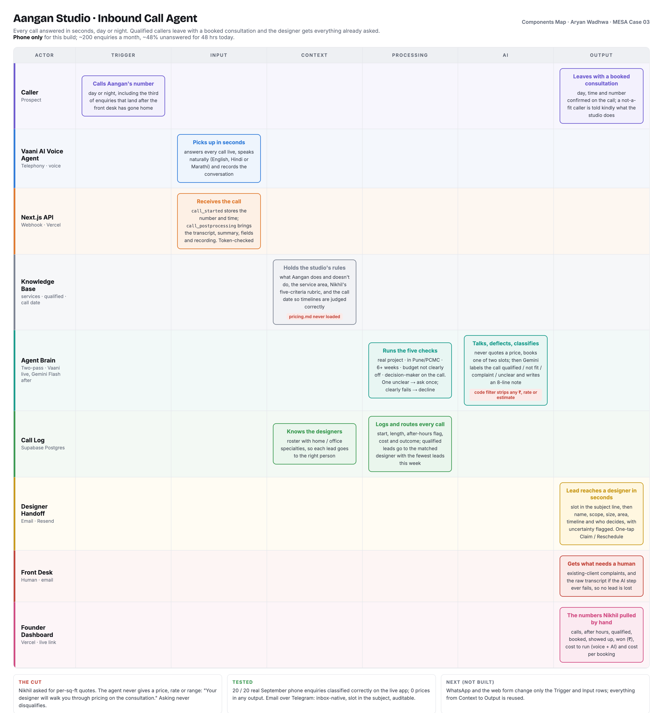

# Aangan Call Agent

An AI front desk for **Aangan Studio**, an interior design studio in Pune (MESA Case 03, Aryan Wadhwa).
It answers every call to the studio, day or night, qualifies the caller against the founder's own rules, books a consultation during the call, and emails the designer everything that was already asked.

- **Live:** https://aangan-call-agent-aryan.vercel.app (Nikhil's dashboard)
- **Results:** 20 / 20 real September phone enquiries classified correctly; no price, rate or estimate in any output. See [`docs/eval-results.md`](docs/eval-results.md).
- **Components map:** [`docs/component-map.png`](docs/component-map.png) (source: `docs/component-map.html`)
- **Brief and Nine Checks:** [`docs/case-brief.md`](docs/case-brief.md)



## How a call flows

```
Caller ─► Vaani AI voice agent (answers, qualifies on Nikhil's five checks, books a slot)
              │ webhook: call_started + call_postprocessing  (?token= secret)
              ▼
        /api/vaani/webhook  (Next.js on Vercel)
              │ log ─► Supabase (calls, designers)
              ▼
        Gemini Flash classifies against qualified.md + services.md, with the call date
              │
   qualified ─┼─► email the matched designer (Resend): Claim / Reschedule / Recording
              ├─► HubSpot deal (switched on by token)
   complaint ─┼─► email the front desk; a human handles it
   AI failed ─┼─► raw transcript emailed to the front desk, so no lead is lost
   not a fit / unclear ─► logged only
              ▼
        Dashboard: calls, after hours, qualified, booked, showed up, won, cost, cost per booking
```

## The Cut

Nikhil asked for the agent to quote standard per-square-foot pricing. **It never does.** A price said in the studio's voice is heard as a commitment and can't be taken back (check 06).

- The Vaani prompt deflects: "Your designer will walk you through pricing on the consultation."
- `pricing.md` is not in the repo and never loaded into a prompt.
- `lib/gemini.ts` `guard()` strips any rate, estimate or rupee figure from the note and reason. The caller's own volunteered budget passes.
- Asking about price never disqualifies a caller (T02 and T13 both qualify).

## Handoff: email, not Telegram

Designers already work from their inbox. The subject line carries the slot, one-tap Claim stops two designers chasing one lead, and email is a record Nikhil can search and audit. The speed trade-off is covered because the caller already has a booked slot before the email lands.

## Stack

| Tool | Role |
|---|---|
| Vaani AI | Voice agent, telephony, call webhooks |
| Gemini Flash | Classification and the designer note (JSON mode, free tier) |
| Supabase | Call log and designer roster (RLS on, server-only key) |
| Resend | Designer and front-desk email |
| HubSpot | Deal per qualified lead (optional) |
| Next.js on Vercel | Webhook, eval route, Claim/Reschedule pages, dashboard |
| Claude Code | Built and tested end to end |

## Repo layout

```
app/api/vaani/webhook/   Vaani posts every call here
app/api/eval/            Dry-run classifier for past transcripts (no DB, email or CRM)
app/api/lead/claim/      "Claim this lead" (GET confirm page, POST records it)
app/api/lead/reschedule/ "Reschedule"
app/page.tsx             Nikhil's dashboard
lib/                     gemini (+ price guard), email, hubspot, supabase, vaani, signed links
knowledge/               qualified.md + services.md (pricing.md deliberately absent)
scripts/                 eval-cases.json (T01–T20) and run-eval.mjs
supabase/setup.sql       One-shot schema
vaani/agent-setup.md     Voice agent prompt and settings
docs/                    Brief, Nine Checks, components map, eval results
```

## Setup

1. Supabase: SQL Editor → run `supabase/setup.sql` (put your Resend signup email in the designer row).
2. Vercel: import the repo and add the variables in `.env.example`, then deploy.
3. Vaani: paste the prompt from `vaani/agent-setup.md`; Developers → Webhooks → `https://<app>/api/vaani/webhook?token=<VAANI_WEBHOOK_SECRET>` with Call Started and Call Post-Processing.
4. Test without spending call minutes: `node scripts/run-eval.mjs`.

## Limits

- Real inbound calls to a studio number need a paid Vaani number or SIP trunk; the demo uses Vaani's test call.
- Resend's test sender only delivers to the Resend account email until a domain is verified.
- Gemini's free tier allows a limited number of requests a day.

## Extending to WhatsApp and the web form

Only the Trigger and Input change: add a webhook route per channel that normalises into the same `NormalisedCall` shape. Classification, handoff, CRM and dashboard are reused.

Built on the class reference build by anirudhaaiyer-dotcom/Aangan-.
